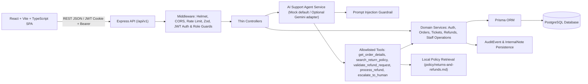

# Kestrel Care — System Architecture

## Overview
Kestrel Care follows a strict layered architecture where all business rules, ownership enforcement, refund calculations, and ₹5,000 escalation thresholds live in backend domain services. The AI support agent is never a source of truth for amounts, permissions, or database mutations; it orchestrates allowlisted typed tools backed by those domain services.

## Key Security & Domain Boundaries
- **Authentication:** `bcrypt` password hashing + JWT with `jti` token revocation on logout (`RevokedToken`).
- **Ownership Isolation:** Every customer query filters by `customerId = req.user.id` and returns `404` when a resource does not belong to the caller.
- **Internal Visibility:** `InternalNote` records and `INTERNAL` messages are strictly excluded from customer endpoints.
- **Refund Validation:** Computed server-side using `decimal.js`, enforcing `DELIVERED` status, 14-calendar-day inclusive window, returnable categories, shipping-fee exclusion, idempotency keys, and `₹5,000.00` human escalation threshold.
